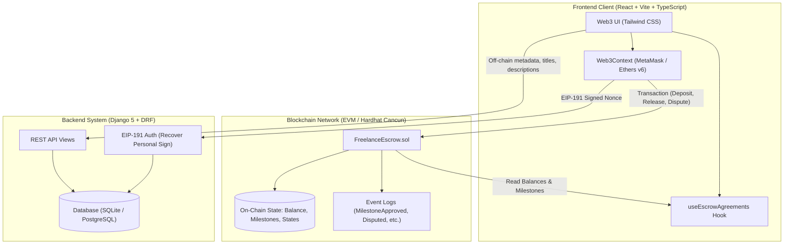
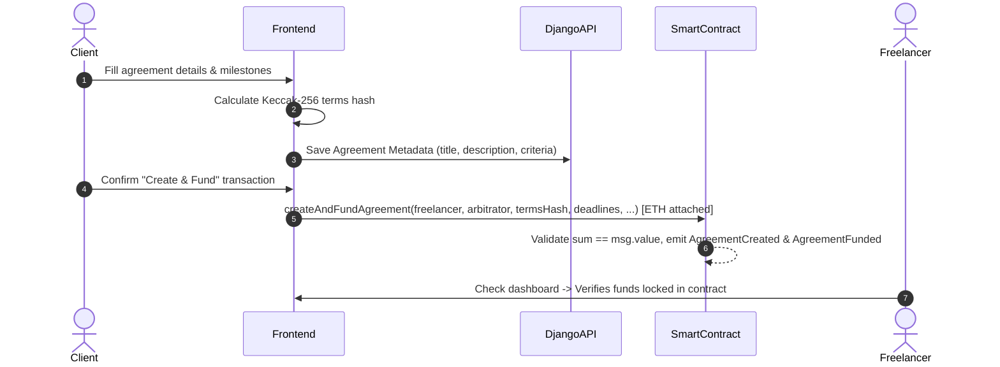
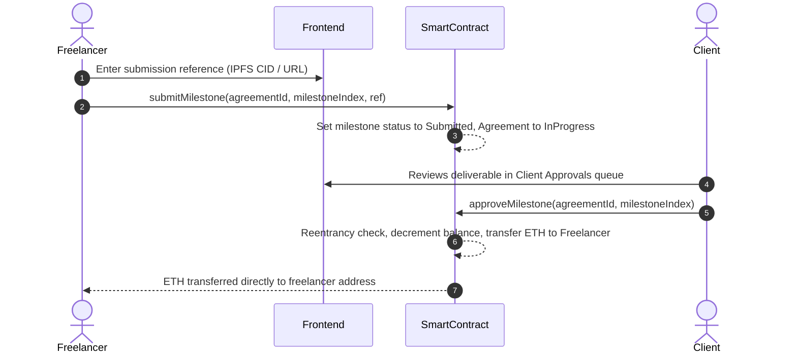
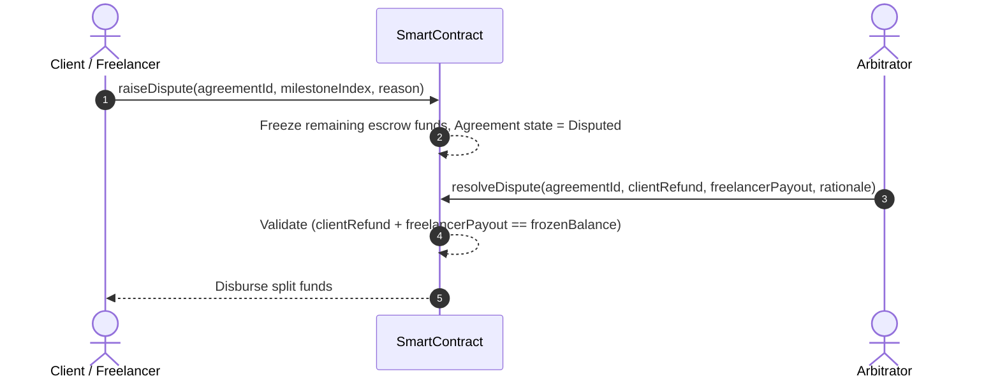

# System Architecture: Freelance Escrow Platform

## 1. Overview
Freelance Escrow is a decentralized Web3 payment assurance application built to eliminate payment uncertainty, defaults, and disputes in freelance engagements. The architecture is segregated into three distinct tiers:

1. **Decentralized Settlement Layer (Smart Contracts)**: The immutable authority for escrow deposits, milestone states, payout execution, and dispute resolution.
2. **Metadata & Off-Chain Coordination Layer (Django REST Framework)**: Manages non-financial metadata, user profiles, deliverable evidence links, cryptographic nonces, and blockchain event indexing.
3. **Client Interface Layer (React + Vite + Ethers v6)**: A responsive fintech-styled Web3 application connecting client, freelancer, and arbitrator wallets directly to the blockchain and backend APIs.

---

## 2. Tiered System Architecture Diagram

---

## 3. Data Flow Sequences

### A. Agreement Creation & Funding Flow

### B. Milestone Delivery & Approval Flow

### C. Dispute & Settlement Flow

