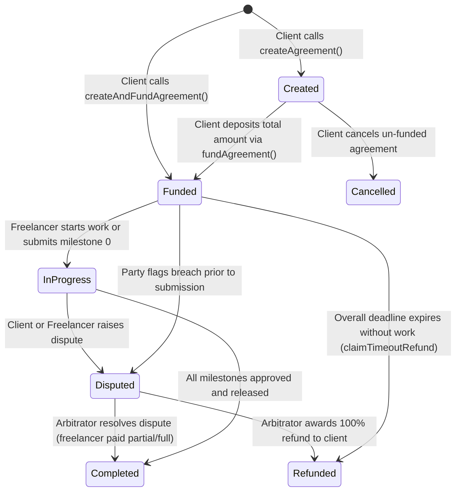

# Smart Contract State Machine & Dispute Policy

## 1. Agreement States & Transition Rules

The `FreelanceEscrow` smart contract enforces strict state transitions. Invalid transitions revert immediately with custom Solidity errors.

---

## 2. Milestone States

Each milestone within an agreement tracks its own independent delivery lifecycle:

| State | Description | Permitted Action |
|---|---|---|
| `Pending` (0) | Milestone is active and waiting for delivery. | Freelancer can submit evidence. |
| `Submitted` (1) | Deliverable evidence is anchored on-chain. | Client can approve and release funds; either party can raise dispute. |
| `Approved` (2) | Client verified work; milestone payout was transferred to freelancer. | Immutable terminal state. Cannot be disputed retrospectively. |
| `Disputed` (3) | Deliverable was contested. | Frozen pending arbitrator ruling. |
| `Refunded` (4) | Arbitrator ruled milestone refund to client. | Terminal state. |

---

## 3. Dispute Policy & Resolution Invariants

### Trust Assumptions & Design Principles
1. **Quality Oracle Limitation**: A public blockchain cannot independently determine whether code compiles, whether UI designs meet aesthetic standards, or whether text deliverables satisfy qualitative requirements.
2. **Explicit Client Acceptance**: Milestone payments only trigger upon explicit client approval or designated arbitrator settlement.
3. **Conservation of Value Invariant**:
   $$\text{Client Refund} + \text{Freelancer Payout} == \text{Frozen Escrow Balance}$$
   The smart contract reverts with `SettlementMismatch` if the arbitrator attempts to create or destroy funds.
4. **Reentrancy Protection**: All fund disbursements use OpenZeppelin's `nonReentrant` guard and the Checks-Effects-Interactions pattern.
